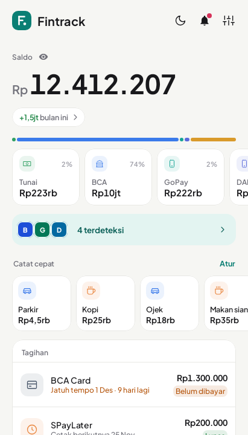
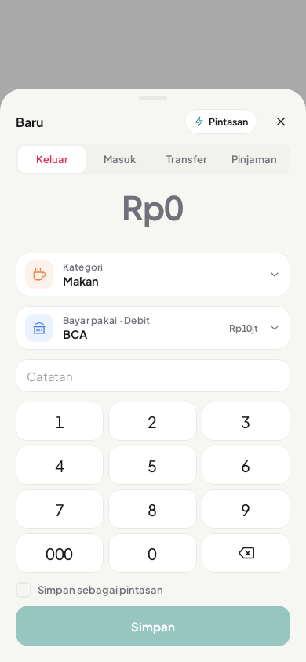
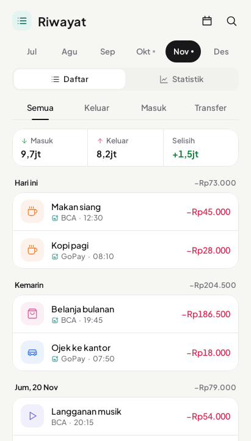
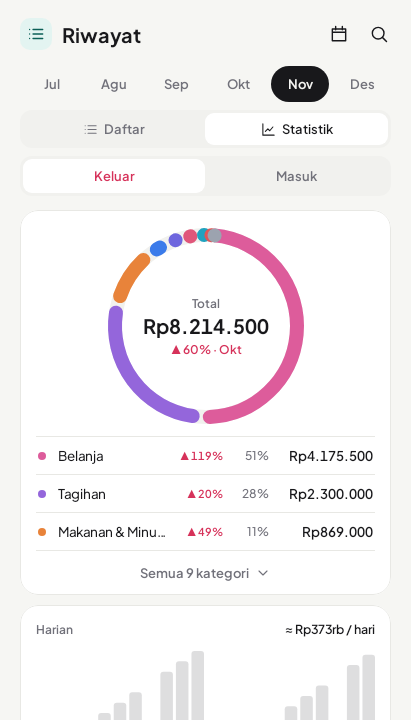
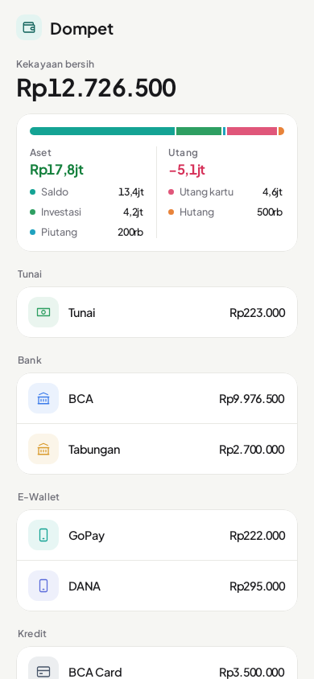
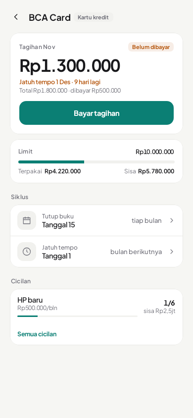
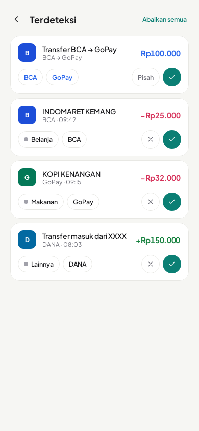
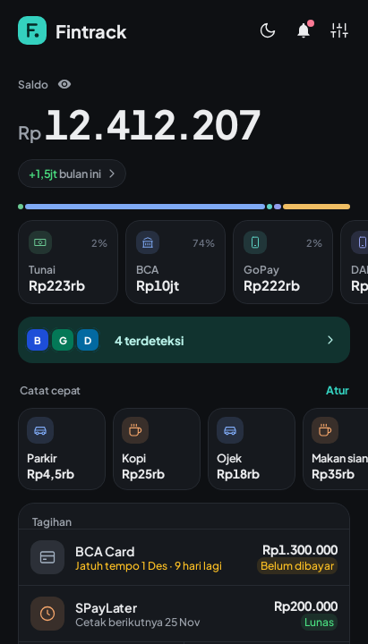

# Fintrack

Fintrack is a fully offline, private personal finance tracker for Android. It is built with Kotlin and
Jetpack Compose. The UI is in Indonesian. The app has no network permission and no network libraries:
your data never leaves the phone. The specification lives in [docs/](docs/README.md).

## Screens

<table>
  <tr>
    <td></td>
    <td></td>
    <td></td>
    <td></td>
  </tr>
  <tr>
    <td align="center">Beranda</td><td align="center">Catat transaksi</td>
    <td align="center">Riwayat</td><td align="center">Statistik</td>
  </tr>
  <tr>
    <td></td>
    <td></td>
    <td></td>
    <td></td>
  </tr>
  <tr>
    <td align="center">Dompet</td><td align="center">Kartu kredit</td>
    <td align="center">Terdeteksi</td><td align="center">Mode gelap</td>
  </tr>
</table>

The images are the Roborazzi screenshot references, so they always show the current UI.

## Features

- **Fast entry**: expense, income, transfer (with admin fee) and loans from one sheet with a keypad, category
  tiles and quick-entry shortcuts.
- **Wallets and net worth**: cash, bank, e-wallet, credit card, pay-later and investment wallets; assets
  versus debts at a glance.
- **History and statistics**: month strip and period picker, filters and search, category donut and daily bars.
- **Credit cards and instalments**: statement and due dates, bill payment, 0% instalment schedules, early payoff.
- **Loans and investments**: money lent or borrowed with repayments; investments with manual valuations and gain.
- **Budgets and reminders**: per-category limits with alerts; reminders for bills, loans, investments and backups.
- **Notification detection**: reads bank and e-wallet notifications into an inbox to confirm or dismiss
  (the bank parsers are added once real sample notifications are collected).
- **Privacy and safety**: SQLCipher-encrypted database, PIN and biometric lock, hide from recents,
  password-encrypted backup and restore, CSV export.
- **Look**: light and dark themes, readable at large font sizes, TalkBack labels.

## Requirements

- JDK 21
- Android SDK with compileSdk 37.2 (`ANDROID_HOME` must point to it, e.g. `%LOCALAPPDATA%\Android\Sdk` on Windows)
- Git Bash or any POSIX shell for the commands below

## Setup

Activate the git hooks once per clone (repository-local, not global):

```sh
git config core.hooksPath .githooks
```

- `pre-commit`: `./gradlew spotlessCheck detekt`
- `commit-msg`: validates the commit header format and doc IDs, rejects AI attribution
- `pre-push`: `./gradlew check`

## Main commands

| Command | Purpose |
|---------|---------|
| `./gradlew check` | Full quality gate (format, detekt, lint, tests, architecture, coverage, screenshots) |
| `./gradlew test` | Unit tests |
| `./gradlew spotlessApply` | Format the code |
| `./gradlew recordRoborazziDebug` | Update screenshot references (only for intended UI changes) |
| `./gradlew installDebug` | Install the debug build on a connected device |
| `sh design/screens/render.sh <name> "<taps>"` | Render a screen of the design mockup to `design/screens/` |

## Documentation

- [docs/README.md](docs/README.md): index of the specification
- [docs/12-git-workflow.md](docs/12-git-workflow.md): commit and hook rules
- [docs/05-coding-standards.md](docs/05-coding-standards.md): limits and forbidden constructs enforced by `check`
- [design/screens/](design/screens/): the mockup rendered per screen, the reference for the UI
